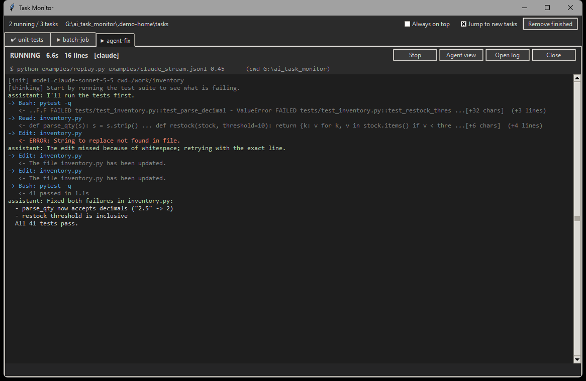
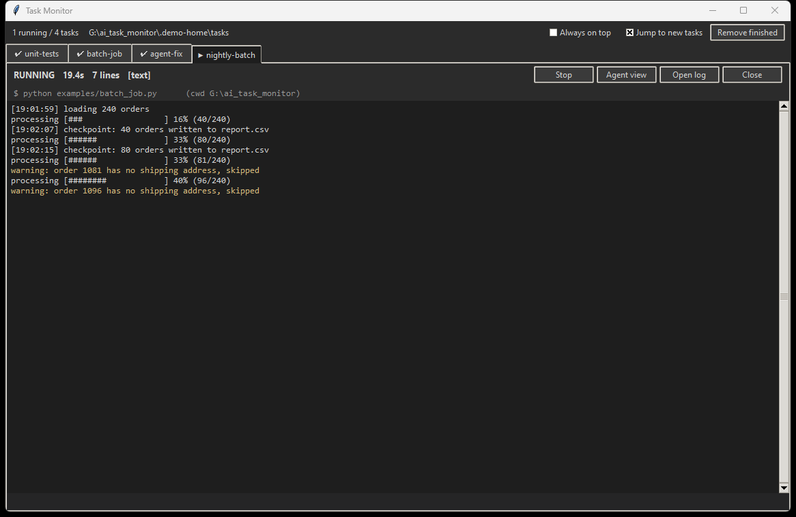

# taskmon

**See every command your AI agent runs, live, while the agent reads only a short summary.**

When Claude Code (or any coding agent) runs a build, a test suite, a long script or *another AI agent*, it usually redirects the output to a file or pipes it through `tail`, and you see nothing until the command finishes. That's a problem when the command runs for a long time, or does something you'd want to stop. Dumping the full output back to the agent is no better: it burns tokens and context.

taskmon sits in between:

- **You** get a window with one tab per task that streams the full output live, with errors highlighted, progress bars updating, and a Stop button.
- **The agent** gets a compact summary when the task ends: status and exit code, the unique error lines, a warning count and the last few lines. Agent-CLI tasks get the final answer, turn count, cost and the tools used. The agent can `grep` or `tail` the full log afterwards if it needs more.



It is a single Python file using only the standard library (tkinter for the window), so there's nothing else to install.

## Install

```bash
pip install git+https://github.com/OWNER/taskmon     # or: pipx install git+https://github.com/OWNER/taskmon
taskmon install-skill                                # teach Claude Code to use it (~/.claude/skills/taskmon)
```

Without installing, you can copy `taskmon.py` anywhere and use `python taskmon.py ...`. `install-skill` writes the right invocation into the skill either way.

On Linux, tkinter may need to be installed separately (`apt install python3-tk`). Without it, tasks still run and summarize; only the window is missing.

## Use

```bash
taskmon run -n build -- npm run build          # the window opens; prints the summary on exit; returns the command's exit code
taskmon run -n tests --sh "pytest -x && ruff check ."
taskmon run -n agent -- claude -p "fix the failing tests" --output-format stream-json --verbose
```

A failing build hands the agent something like this, instead of 1,800 lines:

```
[taskmon] build: FAILED (exit 2) | 42.3s | 1834 lines
log: ~/.taskmon/tasks/build/output.log
-- matching lines before the tail (2 shown) --
120: src/api.ts(14,5): error TS2322: Type 'string' is not assignable to type 'number'.
988: src/db.ts(3,1): error TS2307: Cannot find module './pool'.
warnings: 37 lines (see: grep build warn)
-- last 15 lines --
...
```

Follow-up commands, for when the summary isn't enough:

| Command | Purpose |
|---|---|
| `taskmon summary NAME...` | Compact status; works while the task is running |
| `taskmon grep NAME REGEX [-C 2] [-m 30]` | Search the full output |
| `taskmon tail NAME [-n 20]` | Last lines of the output |
| `taskmon wait NAME... [--any] [--timeout S]` | Block until done, then print summaries (pairs with `run --detach`) |
| `taskmon list` / `stop NAME` / `clean [NAME]` | Manage tasks |
| `taskmon gui [--restart]` | Reopen the window, or restart it gracefully after an upgrade |

Useful `run` options: `--cwd DIR`, `--timeout SEC`, `--tail N`, `--grep REGEX` (surface extra lines), `--input FILE` (feed stdin, e.g. a long prompt), `--detach`, `--no-gui`, `--format auto|text|claude|codex`.

With Claude Code, run tasks with the Bash tool's `run_in_background`. The agent is notified when the task exits, and the only output it reads is the summary. It doesn't poll, and it doesn't spend tokens while the task runs.

## Watching other AI agents

When the command is an agent CLI that emits JSON events, taskmon detects it. It renders a readable transcript for you: thinking, messages, each tool call with a short result preview, and errors in red. The agent that launched it gets only the outcome:

```
[taskmon] agent-fix: OK (exit 0) | 3m12s | 16 lines
turns=7 | cost=$0.0412 | tools: Edit x3, Bash x2, Read x1 | tool errors=1
-- result --
Fixed both failures in inventory.py ...
```

Supported formats:
- Claude Code: `claude -p ... --output-format stream-json --verbose`
- Codex: `codex exec --json ...`

To try the transcript view without running a real agent, replay a recorded session:

```bash
taskmon run -n agent-demo -- python examples/replay.py examples/claude_stream.jsonl
```

## Ordinary commands



Builds, test suites, installers, servers and data jobs all work the same way. ANSI colour codes are stripped. A progress bar that redraws itself with `\r` keeps only its last frame in the log, while the yellow strip at the bottom of the tab shows the frame currently being drawn. Try `taskmon run -n batch -- python examples/batch_job.py`.

## How it works

- `run` starts the command with stdout and stderr merged into a pipe, and writes `~/.taskmon/tasks/<name>/`:
  - `output.log`: the full output
  - `display.log`: the readable transcript, for agent streams
  - `partial.txt`: the line being drawn, for progress bars
  - `summary.txt`: refreshed every 2s and again at exit
  - `meta.json`: status, exit code, timing and paths
- The window is only a viewer that polls those folders. **Closing or restarting it never affects running tasks.** The next `run` reopens it, or you can run `taskmon gui`.
- There is one window per task folder (`TASKMON_HOME`). It holds an OS lock on `gui.lock`, which is released automatically if the window dies. Separate folders, e.g. one for tests, get separate windows that never interfere. `taskmon gui --restart` asks the open window to close itself, and doesn't kill anything.
- **Stop** (in the window) and `taskmon stop` drop a `stop` flag file. The runner sees it and kills the whole process tree.
- **Agent view** (in the window) shows exactly the summary the agent will read.

Environment variables:
- `TASKMON_HOME`: the state folder (default `~/.taskmon`)
- `TASKMON_NO_GUI=1`: never open the window

## Development

```bash
python -m unittest discover -s tests -v
```

CI runs the suite on Windows, macOS and Linux. The window itself has been tested by hand on Windows 11. Reports from macOS and Linux desktops are welcome.

## License

MIT
